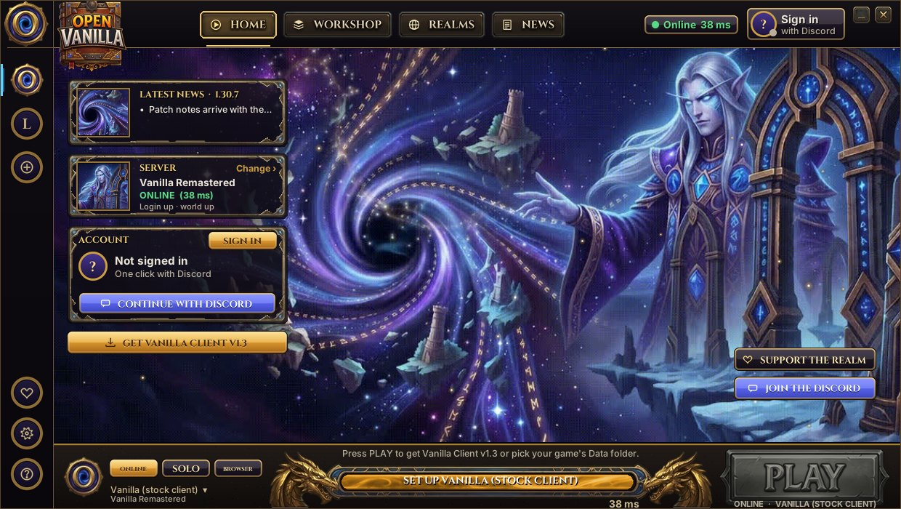
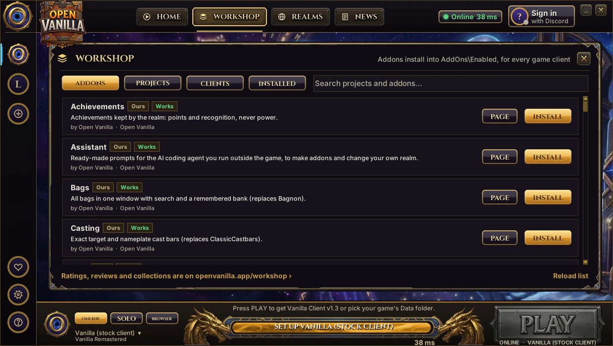

# Open Vanilla Launcher

**`OpenVanilla.exe`: the one program players run.** Pick a realm and a game client, sign in with Discord, play online, solo or in the browser, manage addons from the Workshop, and stay up to date with signed updates.



## Features

- **One PLAY button** with **ONLINE** (the realm you picked), **SOLO** (a whole world with playerbots on your PC, set up for you) or **BROWSER**. The bar above PLAY says what's missing, and pressing PLAY fixes it.
- **The native Open Vanilla engine** (built on [benilla](https://github.com/samwhosung/benilla)), the browser client, or your own stock Vanilla client, with the realmlist set for you.
- **Workshop:** addons, game clients and community mods; turn any addon off with one click, install from a `.zip`.
- **Signed updates** download quietly and install with one press; **live news** reaches every launcher within minutes.
- **Your AI, optional:** Settings > AI sets up an AI coding agent you already have to change your own copy ([agent kit](https://github.com/orionopenwow/openvanilla-agent-kit)).



## Get it

Download `OpenVanilla-Setup-<version>.exe` (or the `.zip`) from the [latest Open Vanilla release](https://github.com/orionopenwow/OpenVanilla/releases/latest). You need your own Vanilla game files (build 5875); Open Vanilla never ships or changes them.

## Build from source

```
Play Open Vanilla.bat                                      # run from source (Python 3.10+)
py -3 packaging\build_repack.py --engine-exe PATH          # build OpenVanilla.exe and the release zip around an engine you built
```

Everything about layout, Play Solo, updates and live content: [docs/LAUNCHER.md](docs/LAUNCHER.md). Release notes: [CHANGELOG.md](CHANGELOG.md).

## Part of Open Vanilla

[Open Vanilla](https://github.com/orionopenwow/OpenVanilla) is a free, open-source, community-built Vanilla project ([openvanilla.app](https://openvanilla.app/), [Discord](https://discord.gg/r6nj5p8U4)). Its products:

- [Vanilla Forge](https://github.com/orionopenwow/vanilla-forge): The Open Vanilla creator app: maps, models, creatures, quests, items and addons, tested in a copy of your game and published as a signed pack.
- [Vanilla Agents](https://github.com/orionopenwow/vanilla-agents): Your AI coding helpers as heroes in a cosy inn: you roam, they work, a checker verifies every quest.
- [Herald](https://github.com/orionopenwow/herald): The Open Vanilla Discord bot, the in-game World chat bridge, and Herald Autopilot: he plays a character for you, simulates gear and learns from play.
- [Open Vanilla Server](https://github.com/orionopenwow/openvanilla-server): Everything that runs a realm: the realm images and CMaNGOS patches, the web/asset service, Server Studio, Play Solo packs, the relay, and the turnkey Hetzner deployment.
- [Open Vanilla Launcher](https://github.com/orionopenwow/openvanilla-launcher) (this one): OpenVanilla.exe: play online, solo or in the browser, the Workshop, signed updates and live news; plus the release packaging.
- [Vanilla Remastered UI](https://github.com/orionopenwow/vanilla-remastered-ui): The in-game addon suite (WenillaCore, Quests, Transmog, Achievements, Guilds and the rest), Classic+ data, and the Workshop addon catalog.
- [openvanilla.app](https://github.com/orionopenwow/openvanilla-site): The Open Vanilla website (GitHub Pages) and the player manual.
- [Open Vanilla Devkit](https://github.com/orionopenwow/openvanilla-devkit): Test a change in seconds on your PC, try it against the live realm, and let a staging realm prove it first; plus the project's checks and tests.
- [Open Vanilla Agent Kit](https://github.com/orionopenwow/openvanilla-agent-kit): Let an AI coding agent change your copy of Open Vanilla for you: addons, interface, your own realm's rates and NPCs.
- [Open Vanilla Art & Tools](https://github.com/orionopenwow/openvanilla-art-tools): Art sources, UI kits and the generator scripts behind the launcher, site and addon artwork; plus the project's maintenance tools.

## License

MIT: see [LICENSE](LICENSE).

## About this repository

This repository is published from **Open Vanilla** (commit `a0f9553ebb`: a). Changes are made there and arrive here with each release, so please open issues and pull requests on [Open Vanilla](https://github.com/orionopenwow/OpenVanilla/issues).

World of Warcraft is a trademark of Blizzard Entertainment, Inc. Open Vanilla is an independent fan project, not affiliated with or endorsed by Blizzard Entertainment. No Blizzard game files are included: you need your own.
